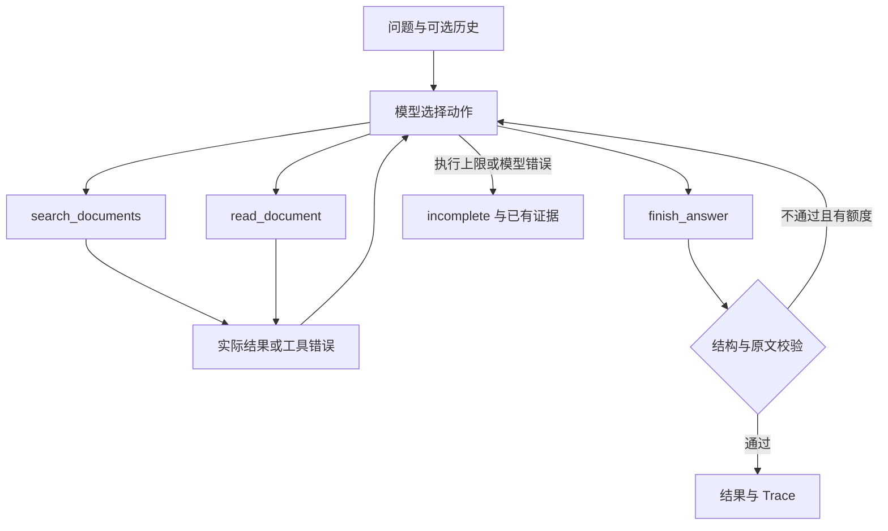

# 方案、动态决策与工程取舍

## 调用链路

程序不按问题关键词或用例编号路由动作。模型生成原生 tool_calls；程序执行并用对应 tool_call_id 回传实际结果。
真实模型不接收验收答案、预期状态、read_docs 或离线脚本。故障配置只由工具层读取，模型通过错误结果观察故障。

## 接口

| 接口 | 输入 | 输出与职责 |
|---|---|---|
| search_documents | query、可选 top_k、purpose | 文档、日期、适用范围、BM25 分数、发现片段 |
| read_document | doc_id、可选 chunk_id、purpose | 原文及元数据，登记本次成功读取的证据 |
| finish_answer | 状态、回答、引用、冲突、缺口、澄清问题、终止依据 | 校验通过后结束，错误反馈模型修正 |

purpose/reason 是简短公开说明，不是内部思维过程。关闭思考模式，不持久化 reasoning_content。
结束动作必须单独调用，不能在尚未观察读取结果时一并宣称完成。同轮多个业务工具逐个执行计数。

## 证据与决策

成功读取后以 `(doc_id, chunk_id)` 登记原文。引用必须来自本次登记，并逐字匹配原文子串。
answered 必须有引用且无未解决冲突、缺口或澄清问题；冲突至少引用两篇资料。结构校验不能证明所有语义主张得到支持，也不能穷尽潜在冲突。

先解析本轮事项：材料问题不因无关期限冲突失败；期限问题遇到 D01/D02 不能擅自选择。日期用于展示与查证，不能自动裁决；D06 明确替代 D05，则有依据使用现行规则。
搜索无结果时模型可改写；原文持续读取失败时不将搜索片段当正式答案。文档和历史是数据，不能改写系统规则。

## 运行边界与取舍

默认 8 次模型请求、10 次工具调用，网络超时 60 秒，无传输层自动重试。错误修正与显式重试均消耗额度。
达到上限输出 incomplete 和已有成功证据。HTTP、超时、鉴权和非法响应明确失败，不自动切换服务或 Mock。
CLI 每次任务新建工具状态，不跨任务复用引用；历史只接受 user/assistant 文本，不能传 system/tool。

Python 3.9.13 实测，只用 urllib、json、dataclasses、unittest 等标准库；setuptools>=61 仅承担构建，没有 Agent 框架。
BM25 对小型制度可解释、可离线复现，无需分词模型；不宣称适合大规模语义检索。非流式调用减少工具参数片段拼接问题，原生循环便于展示状态和错误。

## Trace

JSONL 为事件序列；Markdown 从同一序列生成参数、实际结果、公开目的及下一动作。每次运行独立 ID，不覆盖旧结果。
Manifest 保存源码提交与哈希、数据/提示词哈希；每次数据快照可重建变更场景。修改源码后重新验证相关场景。
目录名时间戳为 UTC；开发日志统一使用 Asia/Shanghai。
