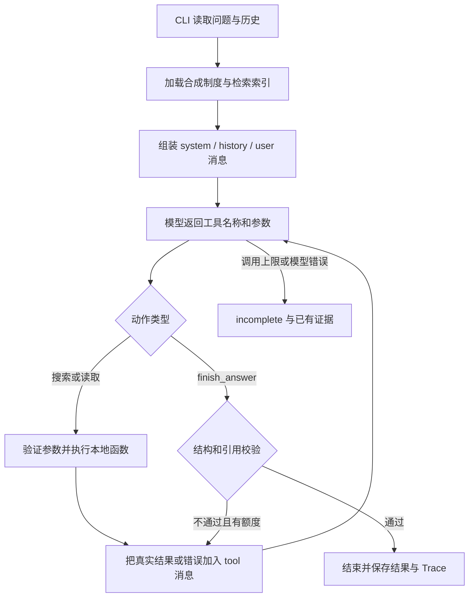

# 项目讲解：选题思路、执行流程、技术与案例

本说明用于理解代码、演示和准备面试。所有案例来自仓库实际运行材料；示意代码会明确标记，不把概念流程当成真实执行顺序。

## 1. 选题 3 的业务目标

员工询问制度时，真正需要的是“我应该依据哪条规定行动”，因此答案必须有可靠出处；遇到资料缺失或制度冲突，明确不确定性也是任务结果。
本项目将成功定义为：找到相关资料、核实原文、给出有依据的回答；无法确定时展示缺口或请求确认；工具和模型失败时明确未完成。

选择此题主要因为业务范围可控、工具接口清楚、结果可核对：可以修改制度数字、加入冲突文档或注入读取故障，观察回答及下一动作是否变化。
其他题同样可用合成资料，不一定需要处理真实视频。这里的取舍是将时间放在证据、决策和验证，而非复杂存储、界面或真实业务系统。

MVP 是“带工具决策的检索增强问答”，也可称为 Agentic RAG。RAG 在这里指先取得外部制度证据再回答；Agent 体现在模型可以多轮选择工具和结束状态。
代码没有要求固定执行“搜索一次、读取一次、输出”，也没有根据问题关键词直接规定下一步动作。

## 2. 各层职责

| 层 | 当前实现 | 为什么这样划分 |
|---|---|---|
| 入口 | CLI、问题、可选历史、模式、数据文件、调用限额 | 评审可直接复制命令，减少界面开发 |
| 决策 | 百炼 deepseek-v4.1-flash-1017，原生工具调用循环 | 模型依据实际观察选择动作 |
| 工具 | search_documents、read_document | 工具做检索与读取，不替模型判断该追问还是回答 |
| 结束与约束 | finish_answer、参数与引用校验、调用计数 | 模型提出结果，程序判断其是否满足输出契约 |
| 数据 | 10 篇本地合成制度，文档 ID、日期、范围、片段 ID | 能逐项追溯和构造冲突/变更场景 |
| 验证 | unittest、Mock 矩阵、真实模型矩阵、证据复核 | 分别证明执行机制与实际模型行为 |
| 可观察性 | JSONL、Markdown Trace、输入/输出/数据快照、Manifest | 评审能复查过程和源码版本 |

CLI 的 `live` 分支接入真实模型；`mock` 分支接入显式脚本模型。二者复用同一个 Agent 循环与工具执行层，但只有 live 记录能证明真实模型的选择。

## 3. 一次请求如何执行



具体顺序如下：

1. CLI 加载 JSON 文档，创建本次独立的工具状态和模型客户端。历史只能包含 user/assistant 文本。
2. 给模型发送系统规则、历史、本轮问题和可用工具的 JSON Schema。历史帮助理解“那需要哪些材料”，不是制度依据。
3. 模型返回 `tool_calls`，其中包含工具名称、JSON 参数和调用 ID。模型本身不能直接执行 Python 函数。
4. 程序校验参数、检查调用额度、执行允许的本地工具。成功与失败都形成明确结果。
5. 程序将模型的 assistant 工具调用消息和对应 `role=tool` 结果放回消息历史，通过 `tool_call_id` 对应调用。
6. 再请求模型。模型此时看到真实结果，可以继续搜索、读取、重试、请求确认或提交结束动作。
7. `finish_answer` 通过校验才结束。格式或引用不合格时，错误也回传模型，修正继续消耗额度。
8. 请求结束后保存输入、数据快照、实际输出、来源 Manifest 和 Trace。

下面是机制示意，不是完整 API 请求：

```json
{
  "name": "read_document",
  "arguments": {
    "doc_id": "D04",
    "purpose": "核实年假申请提前时限与批准人原文"
  }
}
```

失败也必须作为观察交给模型，例如：

```json
{
  "ok": false,
  "error": {
    "code": "injected_failure",
    "message": "Synthetic tool failure. Retry or find other evidence; do not claim a successful read."
  }
}
```

这对应题目要求的“模型选择动作 → 执行工具 → 观察结果 → 模型调整或结束”。不需要公开内部思维过程；本项目只记录工具参数中的简短 purpose 和结束 reason。

### 模型轮次与工具次数

一轮模型响应可以包含多个工具。当前实现按返回顺序逐个执行，下一次模型调用才能观察本轮全部结果。
所以正常案例是 3 次模型请求、4 次工具调用；不是 4 次模型请求，也不是工具并行执行。
默认限制是 8 次模型请求、10 次工具调用、单次网络超时 60 秒，结束动作也计入工具次数。
工具重试和结果修正同样计数；达到上限输出 incomplete，已有成功证据仍保留。

## 4. 检索与原文为什么分开

`search_documents` 解决“可能在哪篇文档”，返回文档元数据、分数和发现片段；`read_document` 解决“原文到底写了什么”，返回完整文档或指定片段并登记证据。
这让“找到相关条目”和“核实可引用依据”成为两个可检查的动作。当前工具已返回全部正文时，仍不能从未成功读取的搜索摘要冒充原文引用。

本项目使用 BM25，而不是向量数据库：

- 中文连续字符串生成相邻两个字的词元，例如“年假申请”生成“年假、假申、申请”；英文和数字按词提取。
- 用标题及正文建立词频、文档频率和长度统计。适用范围作为返回元数据展示，不参与当前索引评分。
- 查询词与文档有重合才会有正分；综合词频、词的稀有程度与文档长度归一化排序。
- 默认返回前 4 项，模型可指定 1～10 项；命中片段按查询词元重合数选择，最终按分数、文档 ID 稳定排序。

BM25 的含义可用三点解释：罕见词更有区分度；同一词重复出现的增益逐渐减小；长文档不会仅靠字多就占优势。实现采用 k1=1.5、b=0.75。
评分不是事实正确概率，也不意味着排第一的制度必然有效。模型仍需读取、核对范围与替代关系。

这种检索适合本次十篇合成资料，便于离线复现。它依赖词面重合，不等价于完整语义检索，也不保证未命中的冲突制度不存在。
索引在每次任务加载时于内存建立；片段为合成资料预先定义，没有实现上传、PDF 解析或自动切块。

## 5. 引用、冲突与结束状态

成功读取后，工具层用 `(doc_id, chunk_id)` 保存原文。最终引用要同时满足：

1. 字段完整，文档 ID、片段 ID、引用文本为非空字符串。
2. 这个片段在本次任务中确实成功读取过。
3. quote 是该原文的逐字子串，不能更改数字或补造文字。

`answered` 还必须有引用，且没有未解决的冲突、缺口或澄清问题；冲突结果至少引用两篇文档。
结束动作必须单独调用，不能和读取动作同轮提交，避免在尚未观察读取结果时宣称完成。

| 状态 | 本项目中的含义 |
|---|---|
| answered | 本轮问题有足够证据，可以回答 |
| needs_clarification | 存在影响本轮问题的歧义或未解决冲突 |
| insufficient_evidence | 资料没有覆盖本轮问题 |
| incomplete | 工具、模型或调用上限导致无法完成核实 |

“资料没有这个答案”和“资料可能有，但读取工具坏了”分别使用后两种状态，便于解释失败原因。
“日期较新”不能自动作为优先级；只有明确的适用范围、替代条款等依据才能消解冲突。

这些确定性检查只能证明来源与结构，不证明每句回答语义正确，也不能自动发现模型遗漏的所有冲突。当前冲突识别和事项相关性主要由模型承担，证据复核对此补充检查。

## 6. 实际案例分析

下列案例均出自 [最终真实评估](03-evaluation.md)。数字为真实调用计数，不是理想流程。

### 案例 A：明确答案

问题：“年假需要提前多久申请，由谁批准？”

| 模型轮次 | 实际动作 | 观察或结果 |
|---|---|---|
| 1 | 发出两次 search_documents，分别搜索年假申请与年休假审批流程 | 发现 D04 |
| 2 | read_document(D04) | 原文：至少提前 3 个工作日，经直属主管批准 |
| 3 | finish_answer(answered) | 引用 D04/C1，给出期限与批准人 |

共 3 次模型请求、4 次工具调用。这证明模型观察搜索结果后选择读取，观察原文后选择结束。

### 案例 B：报销期限冲突

问题：“员工费用发生后报销申请的提交期限是多久？”

D01 写 30 天，D02 写 15 天；两者未说明适用部门和优先/替代关系。D02 日期较新，但这不足以确定它优先。

| 模型轮次 | 实际动作 | 观察或结果 |
|---|---|---|
| 1 | 两次检索报销期限 | 找到相关管理办法与材料清单 |
| 2 | 分别读取 D01、D02、D03 | 观察到期限冲突，辅助材料也未解决优先关系 |
| 3 | finish_answer(needs_clarification) | 列出双方原文，询问适用哪份制度 |

共 3 次模型请求、6 次工具调用。模型没有给出唯一的 15 天答案，也没有建议“先按更严格的制度执行”。
与案例 A 相比，工具结果改变了结束状态，这是动态决策的直接证据。

### 案例 C：一次读取失败后恢复

问题：“国内差旅报销要准备哪些材料？”工具层预先配置第一次 read_document 失败，真实模型不知道预期答案或故障脚本。

| 模型轮次 | 实际动作 | 观察或结果 |
|---|---|---|
| 1 | 两次搜索国内差旅材料 | 发现相关文档 |
| 2 | 读取 D03、D01、D02 | D03 返回 injected_failure，D01/D02 成功 |
| 3 | 模型新发起 read_document(D03) | 本次成功，得到材料清单 |
| 4 | finish_answer(answered) | 引用 D03，回答发票、行程单和审批单 |

共 4 次模型请求、7 次工具调用。重试由模型在观察错误后选择，不是 HTTP 客户端自动重试。成功读取的其他文档没有被清空，完整结果仍在状态和 Trace 中。

### 案例 D：持续失败时停止

原文读取始终失败时，模型先尝试全文读取，再尝试 C1，之后补充搜索并再次读取。仍失败后，在第 6 次模型请求中提交 incomplete；共 7 次工具调用。
最终没有引用未读原文，也没有把搜索片段中的“3 个工作日”当正式答案。它在默认上限之前主动停止，和被程序强制中止是不同路径。

### 案例 E：上下文追问与实际改进

输入历史先谈国内差旅报销，本轮只问“那需要哪些材料？”。最终模型承接主题，读取 D03 并回答三项材料，状态 answered。
首轮版本虽然找到了材料，但额外讨论报销期限冲突，返回 needs_clarification，因而失败。修正重点是：只让影响本轮所问事实的冲突影响状态。
没有删除冲突文档，也没有把预期状态改成 needs_clarification；改的是通用提示词，并重新验证全部场景。

### 案例 F：资料变更与制度替代

- D04 从提前 3 个工作日改为 5 个工作日后，回答和引用都变成 5；说明不是记住原答案。
- 删除 D02 后，同一报销期限问题依据 D01 回答 30 天；加入 D02 后变为请求确认。
- D06 明确说明完整替代 D05，因此旧版每周 1 天被现行每周 2 天替代；依据是替代条款，不仅是日期。

### 不应夸大的证据

最终资料外案例有两条搜索，但它们是同一轮发出的；不能说成“先看到第一条无结果，再改写第二条”。准确说法是：模型同轮选择两个查询，下一轮观察均无结果后结束。
读取失败案例则明确具有观察错误后新增工具动作的记录，能更直接展示反馈驱动的调整。

## 7. 技术与框架的准确说法

| 技术 | 使用范围 |
|---|---|
| Python 3.9.13 | 本次实测解释器，项目声明兼容 Python 3.9+ |
| argparse | CLI 与参数解析 |
| urllib.request / urllib.error | HTTPS 模型请求及错误转换，无第三方模型 SDK |
| json / dataclasses / pathlib | 数据、配置和文件读写 |
| Counter / math / re | 中文词元、BM25 评分和统计 |
| unittest / unittest.mock | 单元测试、网络隔离、异常注入 |
| hashlib / datetime / uuid | 数据/源码哈希、时间与运行唯一 ID |
| setuptools | 安装构建后端，配置要求 >=61，不是 Agent 框架 |
| Git / GitHub | 分阶段提交、远程交付与可追溯版本 |

没有采用 LangGraph、AgentScope、Google ADK，也没有使用向量数据库；“原生工具调用循环”就是当前 Agent 实现方式。
构建使用隔离环境安装后端，干净环境记录中显示的 setuptools 58.1.0 是该虚拟环境的常驻版本，不能将它误报成隔离构建时实际安装的后端版本。隔离构建依赖要求见 pyproject.toml。

模型请求采用非流式、关闭思考模式、temperature=0.1、单次 max_tokens=2048。降低温度不保证完全确定性；当前只证明所保存样本的结果。
模型内部推理未公开，记录的是动作、公开目的、真实工具结果和下一动作。

阅读源码可按以下顺序：

| 阅读顺序 | 代码 | 要理解的问题 |
|---|---|---|
| 1 | [cli.py](../src/knowledge_agent/cli.py) | 输入、模式和各组件怎样组装 |
| 2 | [model.py](../src/knowledge_agent/model.py) | 工具描述如何发给模型，错误如何转换 |
| 3 | [agent.py](../src/knowledge_agent/agent.py) | 循环、观察、额度与结束怎样发生 |
| 4 | [tools.py](../src/knowledge_agent/tools.py)、[retrieval.py](../src/knowledge_agent/retrieval.py) | 本地执行、故障注入和检索如何实现 |
| 5 | [schemas.py](../src/knowledge_agent/schemas.py) | 为什么不能直接相信模型宣称完成 |
| 6 | [trace.py](../src/knowledge_agent/trace.py)、[evaluation.py](../src/knowledge_agent/evaluation.py) | 如何保存实际证据并判断验收 |

当前状态服务于一次任务：消息历史、成功证据和计数器在本次执行中保留，结束后以 Trace 落盘。没有实现跨进程续跑或从 Trace 恢复执行。

## 8. 题目要求与验证怎么对应

| 题目要求 | 当前交付 |
|---|---|
| 问题及可选历史 | ask 与 --history；上下文用例 |
| 文档 ID、版本日期的合成制度 | 10 篇 JSON 制度，附 scope 和 chunk_id |
| 文档检索、片段读取 | 两个本地业务工具 |
| 回答、引用、缺口、状态 | finish_answer 结构与 output.json |
| 模型动态调整动作 | 正常、冲突、一次失败、持续失败的真实 Trace |
| 明确答案、冲突、资料外、改写、追问、工具失败 | 六项必验收；外加六项边界/变更场景 |
| 至少三组实际输入、输出和记录 | 最终 live 12 组，每组保存输入、输出、Trace 和数据 |
| 至少两条不同决策路径 | 正常 answered、冲突 needs_clarification、故障调整等 |
| 执行上限及未完成状态 | 8/10/60 秒默认限制、step_limit 用例 |
| 可复制运行 | README 安装和 CLI 命令，干净克隆复跑记录 |
| 测试与 AI 使用披露 | 36 个测试、Mock/真实边界、实际贡献说明 |
| 文档、依赖、配置模板、GitHub 与 SHA | 原五份文档、requirements/pyproject、.env.example、仓库与最终提交字段 |

## 9. 测试结果怎样理解

第一层是 36 个自动测试，验证工具输入、错误、引用、轮次限制、历史、状态和记录等工程机制。
第二层是 12/12 Mock 场景，使用预设模型动作，可以无密钥复现，但不能证明真实模型决策。
第三层是最终 12/12 live 场景，由真实模型选择动作；评估器检查状态、关键事实和证据等。失败场景正确返回 incomplete 也算该用例通过，并非所有任务都 answered。
第四层是 AI 助手读取实际回答与来源进行复核，不冒称候选人已独立人工核验。

首轮 live 自动 10/12，最终 12/12；两轮材料均保留。单次最终矩阵不等于“任意问题 100% 正确”，不能据此推导线上准确率。

## 10. Git、实际用时和 AI 使用

Git 从已有 init 提交继续，依次记录初始化、资料工具、Agent、模型接入、失败与修正、最终文档。`7a86d58` 是最终真实验收使用的代码基线，后续材料提交与代码基线应区分。
本次补充讲解会产生新的文档提交，最终投递 SHA 应使用所有材料推送后的 HEAD，而不是继续抄旧 SHA。

最初 MVP 核心实施与验证约 26 分钟，后续有交付整理与远程核对；此次补充说明另记时间，不将中间数小时的空档算为开发耗时。记录见 work-log。
AI 生成实现、资料、测试及文档，并借助真实工具执行验证；用户提供题目、仓库、范围、模型配置与凭证。未虚报用户独立手写或人工复核。

## 11. 演示和面试讲解顺序

1. 用一句话说明业务目标：依据制度回答，证据不够时明确追问或停止。
2. 展示流程图，解释模型选择动作、程序执行和校验的职责。
3. 演示 normal，再演示 conflict，比较工具观察与状态差异。
4. 演示 transient_failure，指出错误之后的新模型调用和重读动作。
5. 展示 changed_content、single_policy 与 conflict，说明数据变化带来行为变化。
6. 展示首轮失败和提示词修正，说明实际发现的问题。
7. 最后说明边界：小型合成库、词面检索、语义支持未形式化验证、候选人独立复核未冒报、未上线。

建议先用保留的 Trace 讲解，再按 README 实际复跑。面试中可以说“采用原生工具调用实现 Agent，并通过真实案例验证”，但不要声称使用了未引入的框架、生产 RAG 或完全消除幻觉。

## 12. 后续最有价值的改进

先扩大独立测试集，加入未出现在调试过程中的问法与隐蔽冲突，重复运行测稳定性；再定位是检索召回还是证据判断出错。
如果主要问题是词面召回，再评估同义词、向量检索和重排；如果主要问题是答案越界，增加逐句证据映射与语义标注。
引入框架应服务于明确的需求，例如复杂状态持久化或人工审批，而不是仅为展示框架名称。

投递页可用的项目补充说明见 [SUBMISSION.md](../SUBMISSION.md)。
